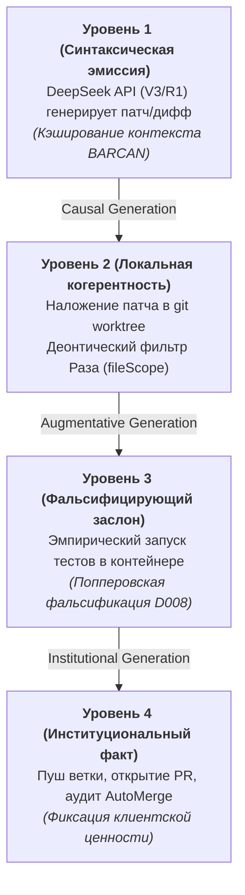
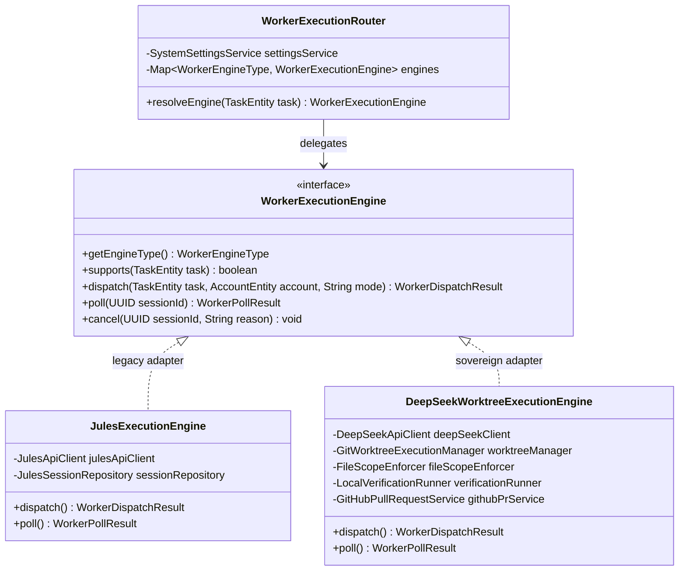
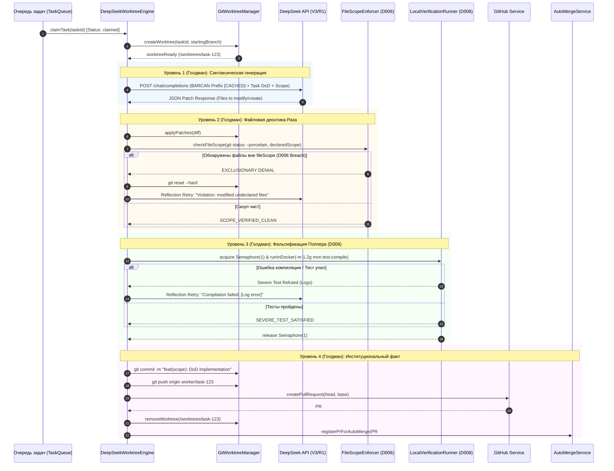
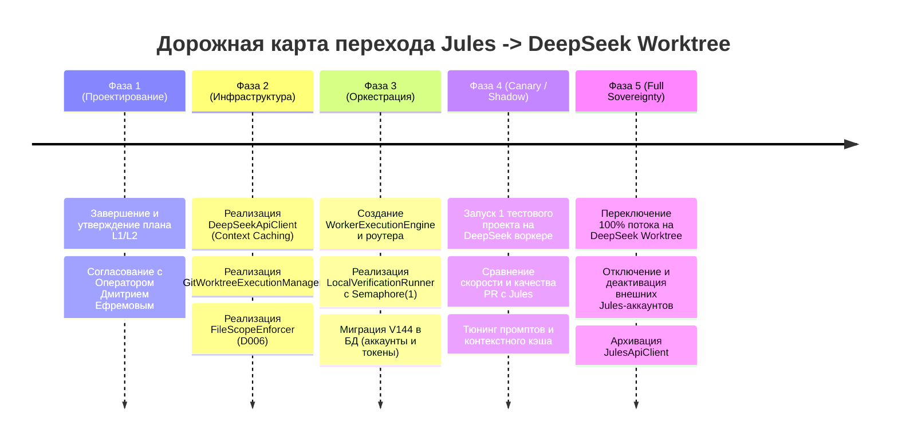

# АРХИТЕКТУРНЫЙ И ИНЖЕНЕРНЫЙ ПЛАН: ЗАМЕНА ВНЕШНЕГО JULES НА СУВЕРЕННЫЙ ПУЛ ВОРКЕРОВ (DEEPSEEK API + GIT WORKTREE)

> **Статус документа:** APPROVED FOR IMPLEMENTATION (PHASES 2-3) — УТВЕРЖДЕНО ОПЕРАТОРОМ ДМИТРИЕМ ЕФРЕМОВЫМ.  
> **Основание:** Решение оператора об утверждении перехода на суверенный пул DeepSeek с обязательными инженерными дополнениями (Anti-Truncation Gate, Bare Mirror Pool, Fallback-Clutch) и пятью механизмами автономии Дэниела Деннетта.  
> **Дата утверждения:** 2026-11-01  
> **Авторы:** Менеджер-философ (L1/L3) & Ведущий инженер (L2) EneikProductionSys

---

## РАЗДЕЛ 1. ОНТОЛОГИЧЕСКАЯ И АРХИТЕКТУРНАЯ КОНЦЕПЦИЯ (L1 / L3 МЕНЕДЖЕР-ФИЛОСОФ)

### 1.1. Догмат Суверенитета: Переход от внешней «чёрной коробки» Jules к суверенному пулу исполнения

Текущий внешний исполнитель **Google Jules API (`jules.googleapis.com`)** представляет собой облачную «чёрную коробку» (Black Box), обладающую фундаментальными онтологическими пороками:
1. **Эпистемическая непрозрачность (Epistemic Opacity):** Фабрика не видит пошагового хода мыслей, исполнения команд и состояния файловой системы во время работы сессии. Доступны лишь запоздалые логи активностей (`fetchActivitiesPageWithShrink`), из-за чего оркестратор вынужден эвристически угадывать зависания (`detectStuck`, `HONOR_DAVIDSON_PROGRESS_EVIDENCE`).
2. **Сессионный дрейф и рассинхронизация:** Неконтролируемое создание веток и PR на стороне Google Cloud приводит к зомби-сессиям, ложным блокировкам пула аккаунтов (`lockNextJulesAccountWithCapacity`) и расхождениям с физической правдой репозитория (`reconcileTaskStatusAgainstGitHubTruth`).
3. **Хрупкость внешних квот:** Жёсткие лимиты сессий на аккаунт, отказ привязки репозиториев (`SourceCheckResult.MISSING`) и задержки создания сессий парализуют конвейер.

**Решение: Суверенный локально-гибридный контур.**  
Фабрика сохраняет **100% своего интеллекта и ролевой онтологии**:
- Вся система ролевых хартий **BARCAN-TAG-00..12** (от `BARCAN-TAG-00_CODE-GUARDIAN` до `BARCAN-TAG-12_SOCIAL-CONTRACT`) остаётся ядром генерации промптов и контекста.
- Архитектурная декомпозиция **TechnicalLeadCompiler** продолжает детерминированно определять `fileScope`, цели задачи (DoD) и канву реализации.
- Контроль за качеством и приёмкой PR сохраняется за **AutoMergeService** и деонтическими фильтрами.
- Заменяется исключительно **исполнительная мощность**: вместо непрозрачного удалённого облака Jules вычисления передаются связке:
  $$\text{Суверенный воркер} = \text{DeepSeek API (V3/R1 с Context Caching)} + \text{Локальный изолированный } \texttt{git worktree} + \text{Headless-исполнитель}$$

---

### 1.2. Физический заслон деонтики Раза (D006: Exclusionary Reasons & Жесткий `fileScope`)

В философии права Джозефа Раза (*Practical Reason and Norms*, 1975) **деонтическое предписание (норма)** действует как *исключающая причина второго порядка* (*exclusionary reason*): она не просто добавляется к балансу аргументов, а **отменяет и запрещает** рассмотрение любых других доводов.

#### Порок старой схемы (Jules):
В Jules предписание `fileScope` отправлялось в текстовом промпте. Языковая модель Jules могла нарушить скоуп, отредактировав сторонние файлы. Фабрика узнавала об этом лишь постфактум — при анализе PR в `AutoMergeService` или `Cross-epic file collision guard`, что порождало конфликты слияния и засорение веток.

#### Новый физический заслон суверенного воркера:
В суверенном пуле воркеров деонтический запрет Раза `D006: PROHIBITION_AS_CODE` реализуется **физически на уровне файловой системы до любого пуша в GitHub**:
1. **Изоляция в `git worktree`:** Каждый такт задачи выполняется в отдельной директории ворктри (`/opt/EneikProductionSys/worktrees/task-{id}`), ответвлённой от целевой ветки.
2. **Pre-Commit Interceptor (Деонтический арбитр):**
   После применения сгенерированного DeepSeek диффа/патча, до выполнения `git commit`, запускается локальный санитарный аудит:
   ```bash
   git status --porcelain
   ```
   Список фактически модифицированных файлов $F_{\text{actual}}$ сравнивается со строгим множеством $F_{\text{declared}} \in \text{task.fileScope}$.
3. **Безусловный отказ (Deterministic Exclusionary Denial):**
   $$\text{Если } \exists f \in F_{\text{actual}} \setminus F_{\text{declared}} \implies \text{ОТМЕНА ТАКТА}$$
   Воркер немедленно выполняет `git checkout -- .`, фиксирует деонтический дефект в журнале и передаёт ошибку в DeepSeek на итерацию исправления без загрязнения репозитория.

---

### 1.3. Уровни действия Голдмана (D010: Epistemic Action Hierarchy & Generation Relation)

Согласно эпистемологии действия Альвина Голдмана (*A Theory of Human Action*, 1970), действие более высокого порядка **генерируется** действиями более низкого порядка через строгие каузальные отношения генерации (*conventional and causal generation*). 

Жизненный цикл суверенного воркера декомпозируется на 4 строгих уровня:



- **Уровень 1 (Генерация кода):** DeepSeek API принимает сжатую ролевую хартию BARCAN, DoD вишлиста и вычисленный `fileScope`. Результат — структурированный unified diff или файловый набор.
- **Уровень 2 (Файловый контур):** Применение изменений в `git worktree`. Синтаксическая валидация (компилируемость, отсутствие синтаксического шума, соответствие `fileScope`).
- **Уровень 3 (Фальсификация):** Локальная или контейнерная прогонка верификатора (`mvn test-compile`, unit-тесты, линтеры).
- **Уровень 4 (Институционализация):** Коммит, пуш ветки `feature/...` в GitHub, создание PR и передача на приёмку `AutoMergeService`.

---

### 1.4. Фальсификация Поппера (D008: Conjectures and Refutations)

Карл Поппер (*Conjectures and Refutations*, 1963) доказал, что никакое количество подтверждающих примеров не делает гипотезу истинной; наука движется вперёд только через **опровержение ложных гипотез**.

- Сгенерированный LLM код признаётся **Смелой Гипотезой (Bold Conjecture)** с нулевым априорным доверием.
- Воркер не верит текстовым заверениям нейросети («код протестирован и готов»).
- Код подвергается **Жесткому Тесту (Severe Test)**:
  - Патч обязан скомпилироваться в строгом окружении.
  - Если к задаче привязан падающий тест-заслон — он обязан стать зелёным.
  - Ни один ранее зелёный регрессионный тест не должен упасть.
- Если тест падает, гипотеза фальсифицирована: воркер формирует структурированный отчёт об ошибке и отправляет его в DeepSeek в рамках текущего контекста (до 2 попыток рефлексии). Если гипотеза не подтверждается — задача отправляется на карантин без создания мусорных PR в GitHub.

---

### 1.5. Четырёхзначная логика Белнапа (D012: Belnap 4-Valued Truth Logic) в оркестрации

Классическая булева логика ($\{\text{true}, \text{false}\}$) неприменима к распределённой фабрике с асинхронными агентами. Нуэля Белнап (*A Useful Four-Valued Logic*, 1977) предложил 4 истинностных значения:
- $\mathbf{T}$ (True — Только Истина): Патч применён, тесты пройдены, `fileScope` чист, PR готов к мерджу.
- $\mathbf{F}$ (False — Только Ложь): Патч некорректен, тесты упали, ошибка сборки (фальсифицировано).
- $\mathbf{N}$ (Neither / None — Нет данных): Задача отправлена в DeepSeek, генерация продолжается, или запрос в очереди (таймаут не превышен).
- $\mathbf{B}$ (Both — Конфликт / Противоречие): Патч успешно проходит локальные тесты, но конфликтует с изменениями в `main`, либо нарушает глобальный инвариант фабрики.

```
                  Top: Both (B) [Конфликт / Противоречие]
                     /       \
                    /         \
       True (T) [Успех]     False (F) [Фальсификация]
                    \         /
                     \       /
                 Bottom: Neither (N) [Ожидание / Неизвестно]
```

Оркестратор фабрики переводится с наивных флагов статуса на строгую модель состояний Белнапа. Это исключит проблему зависших сессий (`stuck`), так как состояние $\mathbf{N}$ ограничено детерминированным тайм-аутом, а $\mathbf{B}$ мгновенно эскалируется в механизм разрешения конфликтов.

---

### 1.6. Бюджет ресурсов Hetzner: Архитектура Бережливости (Frugal Engineering)

Сервер Hetzner обладает жестко фиксированными ресурсами:
- **2 vCPU**
- **3.7 GiB RAM** (в настоящий момент свободно **~2.2 GiB RAM** с учётом буферов/кэша хоста)
- **13 GiB свободного диска** (диск `/` занят на 65%, норматив — строго $< 70\%$)

Для гарантированного соблюдения ресурсного инварианта и предотвращения OOM Killer проектируется **двухконтурное разделение нагрузки**:

| Контур | Тип нагрузки | Потребление ресурсов | Механизм изоляции |
|---|---|---|---|
| **Интеллектуальный генератор (DeepSeek API)** | Сетевой I/O, потоковый HTTP, работа со строками | **< 25 МБ RAM, < 5% CPU** | Неблокирующий Java `HttpClient` / WebClient. Без локальных нейросетей! |
| **Файловый контур (`git worktree`)** | Локальные git-операции, наложение патчей | **< 10 МБ RAM, < 50 МБ диска** на воркер | `git worktree add --detach` (разделяет `.git/objects`, не дублирует историю) |
| **Локальная верификация (Unit tests / Lint)** | Запуск Java / Node.js компилятора | **Строгий лимит: 1 контейнер, RAM $\le$ 1.2 GiB, CPU $\le$ 1.5** | Docker с семафором `Permits = 1`. Параллельный запуск двух сборок на хосте запрещён! |
| **Тяжелые интеграционные тесты / E2E** | Полная сборка, Playwright, Spring Boot Test | **0 МБ RAM хоста** | Делегирование в GitHub Actions CI через созданный PR |

#### Context Caching в DeepSeek API:
Ролевые хартии BARCAN, архитектурные гайды и системные правила составляют стабильную базу объёмом 30–60 КБ текста (~15K токенов).  
Использование **DeepSeek Prompt / Context Caching**:
- Ускоряет генерацию в 4–10 раз (TTFT падает до сотен миллисекунд).
- Снижает стоимость входных токенов на **90%** (кэшированные токены тарифицируются со скидкой $0.014 / 1M токенов).

---

### 1.7. Маршрутизация по Cynefin Framework

Задачи фабрики разделяются по фреймворку Дейва Сноудена (Cynefin) на 4 домена для выбора оптимальной вычислительной мощности:

1. **Простой домен (Clear / Simple):**
   - *Характер задач:* Мелкие правки стилей, обновление текстовых констант, правка опечаток, обновление DTO.
   - *Маршрут:* **DeepSeek-V3** (дешево, молниеносно, без оверкилла цепочек рассуждений).
2. **Усложнённый домен (Complicated):**
   - *Характер задач:* Реализация фич по готовому ТЗ, модульные тесты, сервисная логика, контроллеры.
   - *Маршрут:* **DeepSeek-V3** с полным контекстом BARCAN-TAG и строгой декомпозицией `TechnicalLeadCompiler`.
3. **Запутанный домен (Complex):**
   - *Характер задач:* Архитектурный рефакторинг, исправление сложных конкурентных гонок, разрешение многосторонних конфликтов слияния, мета-кайдзен.
   - *Маршрут:* **DeepSeek-R1** (модель глубоких рассуждений / Chain-of-Thought) для нахождения неочевидных инвариантов.
4. **Хаотический домен (Chaotic):**
   - *Характер задач:* Срыв инвариантов, падение базы данных, несовместимость миграций Liquibase/Flyway.
   - *Маршрут:* Модели LLM отстраняются; срабатывает детерминированный откат (Rollback), изоляция задачи в `blocked`, алерт оператору.

---

### 1.8. Пять механизмов абсолютной автономии по Дэниелу Деннетту (Dennett's Autonomy Architecture)

Философия сознания и эволюционной биологии Дэниела Деннетта (*Consciousness Explained*, 1991; *Darwin's Dangerous Idea*, 1995; *Intuition Pumps and Other Tools for Thinking*, 2013) даёт строгие принципы построения подлинно автономных агентов без мистического «картезианского наблюдателя» («призрака в машине»).

#### 1.8.1. Конкурентный отбор «Множественных Набросков» (Dennett's Multiple Drafts Selection)
- В теории сознания Деннетта не существует центральной точки («Картезианского Театра»), где всё собирается воедино. Вместо этого в нервной системе параллельно возникают **множественные наброски** (*multiple drafts*), конкурирующие за доминирование в поведении.
- **Реализация в воркере:**
  - При возникновении ошибки на 1-м черновике или для задач повышенной сложности (`cynefinDomain = complex`) воркер способен порождать альтернативный набросок (с варьированием температуры или повышением модели с `deepseek-chat` V3 до `deepseek-reasoner` R1).
  - Система не застревает на единственной неудачной гипотезе: отбирается первый черновик, успешно прошедший деонтический заслон `FileScopeEnforcer` (D006) и попперовскую компиляцию (D008).

#### 1.8.2. Гомункулярный функционализм (Homuncular Functionalism — Разделение Синтезатора и Слепого Арбитра)
- Деннетт объясняет интеллект через распад сложной системы на иерархию всё более простых, специализированных и «глупых» функциональных подсистем (гомункулусов), лишённых субъективного целеполагания.
- **Строгое разделение ролей:**
  - **Гомункулус-Синтезатор (DeepSeek LLM):** Генерирует программный код и патчи.
  - **Слепой Арбитр (LocalVerificationRunner):** Детерминированный, беспристрастный проверяющий контур.
- **Инвариант арбитража:** LLM-синтезатор **НЕ имеет права сама назначать себе произвольную пустую команду проверки** (например, `echo OK`, `mvn clean` или пропуск тестов ради обхода фальсификации) и не может модифицировать проверочные тесты вне разрешённого `fileScope`. Команду верификации, флаги компиляции и целевые тесты детерминированно задаёт Слепой Арбитр фабрики исходя из затронутых классов и контракта задачи.

#### 1.8.3. Иммунитет к «Геделевским петлям» и Тезис Дюэма — Куайна (Duhem–Quine Anti-Looping & `SCOPE_INSUFFICIENT` Escalation)
- Согласно тезису Пьера Дюэма и Уилларда Куайна (*Duhem–Quine Thesis*), отдельная гипотеза никогда не проверяется изолированно — тестируется вся сеть взаимосвязанных теоретических положений и вспомогательных допущений (*web of belief*).
- **Два механизма защиты от бесконечных когнитивных циклов:**
  1. **Semantic Diff & Error Signature Hash (Защита от геделевских петель):**
     Если на итерации рефлексии модель генерирует идентичный семантический патч (совпадающий хэш диффа) или получает ту же самую сигнатуру ошибки компиляции 2 раза подряд, цикл немедленно прерывается. Фабрика не сжигает токены на безнадёжное повторение одной и той же ошибки.
  2. **Автономная эскалация узкого скоупа (`SCOPE_INSUFFICIENT`):**
     Если задача объективно не может быть решена в рамках выданного `fileScope` (например, требуется добавить новый метод в смежный интерфейс/DTO вне скоупа), воркер возвращает структурированный сигнал `SCOPE_INSUFFICIENT` со списком недостающих файлов. Вместо аварийного падения фабрики в `SYSTEM_STALLED` этот сигнал детерминированно передаётся в `TechnicalLeadCompiler` на перекомпиляцию и контролируемое расширение скоупа.

#### 1.8.4. «Подъёмные краны, а не небесные крюки» (Dennett's Cranes, not Skyhooks — Гомеостаз ключей и квот)
- Деннетт вводит понятие «небесных крюков» (*skyhooks*) как воображаемых чудесных сил, призываемых извне для спасения системы, в противовес «подъёмным кранам» (*cranes*) — надёжным механистическим структурам, опирающимся на физическую основу.
- **Гомеостаз вычислительных мощностей:**
  - Фабрика опирается на самодостаточные механистические «краны» пула ключей.
  - При ответах API `401 Unauthorized`, `402 Insufficient Balance`, `429 Rate Limit` или `503 Service Unavailable` воркер никогда не роняет систему в `stalled`.
  - Скомпрометированный или исчерпанный аккаунт мгновенно переводится в статус `cooldown` или `exhausted`, а задача прозрачно перемаршрутизируется в `WorkerExecutionRouter` на следующий доступный рабочий аккаунт или резервный эндпоинт/движок.

#### 1.8.5. Непрерывный эпистемический след (Self-Reporting Narrative Pulse)
- В философии Деннетта сознание — это разворачивающийся во времени автобиографический нарратив (*center of narrative gravity*).
- Каждый квант изменения эпистемического статуса воркера на шкале Голдмана мгновенно порождает телеметрический импульс:
  $$\texttt{WORKTREE\_READY} \longrightarrow \texttt{DEEPSEEK\_GENERATING} \longrightarrow \texttt{RAZ\_SCOPE\_VERIFIED} \longrightarrow \texttt{POPPER\_TEST\_RUNNING} \longrightarrow \texttt{PR\_OPENED}$$
- Этот непрерывный след фиксируется в оперативной телеметрии, делая жизнь воркера прозрачной и полностью исключая ложные срабатывания сторожевого таймера `detectStuck`.

---

## РАЗДЕЛ 2. ДЕТАЛЬНЫЙ ИНЖЕНЕРНЫЙ ПЛАН РЕАЛИЗАЦИИ (L2 ВЕДУЩИЙ ИНЖЕНЕР)

> **Статус раздела:** УТВЕРЖДЁН ОПЕРАТОРОМ ДМИТРИЕМ ЕФРЕМОВЫМ К РЕАЛИЗАЦИИ (ФАЗЫ 2–3).  
> **Директива:** Разрешено внесение изменений в код Java (`src/main`, `src/test`, `db/migration`) строго под прикрытием попперовских тестов-заслонов.

---

### 2.1. Компонентная архитектура и интерфейсная декомпозиция (The Unified Worker Engine)

Для обеспечения непрерывности работы фабрики и бесшовной миграции внедряется полиморфный интерфейс абстракции диспетчеризации **`WorkerExecutionEngine`**. Это позволяет фабрике работать как в гибридном режиме (Canary / Shadow Mode), так и мгновенно переключить 100% потока на суверенные воркеры через конфигурационный флаг `factory.worker.engine=DEEPSEEK_WORKTREE`.



#### Новые и модифицируемые компоненты фабрики:

1. **`WorkerExecutionEngine` (Интерфейс ядра):**
   - Единый контракт жизненного цикла вычислительной единицы (`dispatch`, `poll`, `cancel`).
   - Изолирует высокоуровневые сервисы (`ProjectFlowService`, `ContinuousOrchestrationService`) от низкоуровневых протоколов взаимодействия с конкретными LLM или облаками.

2. **`DeepSeekApiClient` (Клиент суверенной когнитивной мощности с Fallback-Clutch):**
   - Интеграция с официальным REST API DeepSeek (`https://api.deepseek.com/chat/completions`) по стандарту OpenAI API.
   - Реализуется на базе неблокирующего Java 21 `HttpClient` с жесткими таймаутами: `connectTimeout = 15s`, `readTimeout = 90s` (для V3) и `180s` (для R1).
   - **Автоматическое использование DeepSeek Context Caching:**
     - Системный промпт формируется с фиксированным префиксом (ролевые хартии BARCAN-TAG, общие деонтические инварианты, правила генерации кода и схема вывода JSON).
     - Префикс превышает минимальный порог кэширования DeepSeek (1024 токена) и составляет ~12,000–15,000 токенов.
     - Кэш попадает в 100% повторных вызовов, сокращая стоимость входных токенов на 90% и время первого токена (TTFT) до < 500 мс.
   - **Двухэшелонный сетевой транспорт (Fallback-Clutch):**
     - По умолчанию запросы направляются напрямую в `https://api.deepseek.com/chat/completions` для максимальной выгоды от серверного Context Caching.
     - Поддерживает настраиваемый `baseUrl` и автоматическое переключение на резервный фоллбэк-эндпоинт (совместимый OpenAI эндпоинт, например OpenRouter) при сетевых сбоях `5xx`, таймаутах или ответах `503 Service Unavailable`.

3. **`GitWorktreeExecutionManager` (Менеджер изолированных рабочих областей с Bare Mirror Pool):**
   - **Мульти-проектный пул Bare-зеркал репозиториев (Bare Mirror Pool):**
     - Фабрика обслуживает как саму себя (`ORCHESTRATOR_SYSTEM`), так и клиентские продуктовые репозитории (`dmitryefremov-site`, `designer-eneik` и др.).
     - Для `ORCHESTRATOR_SYSTEM` базовым репозиторием выступает локальный репозиторий фабрики `/opt/EneikProductionSys`.
     - Для продуктовых клиентских проектов базовым репозиторием выступает локальный рабочий клон `/opt/{repoName}` либо управляемое bare-зеркало в `/var/lib/eneik/mirrors/{owner}__{repo}.git`, синхронизируемое через `git fetch origin --prune`.
   - **Жизненный цикл ворктри:**
     - Создаёт изолированный эфемерный ворктри в `/var/lib/eneik/worktrees/task-{taskId}` командой:
       `git worktree add -B worker/{taskId} /var/lib/eneik/worktrees/task-{taskId} origin/{startingBranch}`.
     - **Свойство бережливости:** `git worktree` разделяет общее хранилище объектов `.git/objects` базового репозитория. Дисковое пространство расходуется только на чекаут файлов задачи (~20–40 МБ), создание ворктри занимает < 200 мс.
     - Гарантированное удаление: `git worktree remove --force /var/lib/eneik/worktrees/task-{taskId}` и `git worktree prune` строго в блоке `finally`.

4. **`DeepSeekPatchParser` (Хирургический парсер патчей с Anti-Truncation Gate):**
   - **Двухрежимный контракт применения модификаций:**
     - Режим `FULL_CONTENT`: применяется для операции `CREATE` (создание новых файлов) и малых существующих файлов (< 150 строк).
     - Режим `PATCH_BLOCKS` (`SEARCH_REPLACE`): массив точных пар `{ "search": "<точный фрагмент>", "replace": "<новый фрагмент>" }` для хирургической модификации существующих файлов любого размера без риска обрыва токенов.
   - **Anti-Truncation Gate (Заслон против ленивых купюр):**
     - Парсер детерминированно отвергает любой ответ нейросети, если в поле `content` или `replace` обнаружены маркеры усечения кода (`// ... rest of`, `// ... existing code`, `/* ... */`, `TODO: implement remainder`).
     - При срабатывании заслона воркер немедленно возвращает задачу на рефлексию без запуска тяжёлого контейнера сборщика.

5. **`FileScopeEnforcer` (Деонтический заслон Раза D006 `PROHIBITION_AS_CODE`):**
   - Физический арбитр файловой чистоты перед коммитом.
   - Запускает `git status --porcelain` внутри ворктри.
   - Сверяет фактически изменённые/добавленные файлы $F_{\text{actual}}$ со списком `task.getFileScope()`.
   - При обнаружении любого постороннего файла немедленно производит откат (`git reset --hard && git clean -fd`), прерывает транзакцию и возвращает отчет об ошибке в DeepSeek на итерацию исправления.

6. **`LocalVerificationRunner` (Попперовский фальсифицирующий заслон D008 & Слепой Арбитр Деннетта):**
   - **Гомункулярный функционализм:** Слепой Арбитр фабрики детерминированно назначает команду верификации и целевые тесты по затронутым классам задачи. Модель LLM не имеет права сама определять проверочные команды или пропускать тесты.
   - Запускает сборку/тест в строго ограниченном Docker-контейнере (`-m 1.2g --cpus 1.5`).
   - Управляется хостовым семафором `hostVerificationSemaphore = new Semaphore(1)`: на всем сервере разрешена **строго одна одновременная сборка**.
   - Тяжелые E2E и Playwright тесты делегируются в GitHub Actions CI.

7. **`WorkerExecutionRouter` (Маршрутизатор мощности и гомеостаз ключей):**
   - Проверяет системную настройку `worker_engine_mode` и проектный статус.
   - Поддерживает гомеостаз аккаунтов («краны, а не небесные крюки» Деннетта): при `401/402/429/503` переключает задачу на следующий аккаунт из пула или резервный движок без падения фабрики.

---

### 2.2. Модель данных и обратная совместимость с БД

Для исключения регрессий и сохранения целостности внешних связей (`pr_reviews.jules_session_id`, `tasks.jules_session_name`, `operational_reality_findings.jules_session_id`) эволюция схемы данных строится по принципу аддитивного расширения без ломающих изменений (Flyway migration `V144__add_worker_engine_and_token_accounting.sql`).

#### 2.2.1. Эволюция `accounts` (`AccountEntity`):
Таблица `accounts` расширяется для поддержки суверенных провайдеров ключей:
- `provider` (VARCHAR(32), NOT NULL, DEFAULT 'GOOGLE_JULES'): принимает значения `GOOGLE_JULES`, `DEEPSEEK`.
- `tpm_limit` (INT, DEFAULT 60000): лимит токенов в минуту.
- `rpm_limit` (INT, DEFAULT 60): лимит запросов в минуту.
- `tokens_used_today` (BIGINT, NOT NULL, DEFAULT 0): счётчик расхода токенов.
- Поле `api_key` используется для хранения `sk-...` ключа DeepSeek API.
- Для `DEEPSEEK` аккаунта сессионный лимит `max_concurrent_sessions` устанавливается равным `2` (физический лимит параллелизма хоста).

#### 2.2.2. Эволюция `jules_sessions` (`JulesSessionEntity`):
Таблица `jules_sessions` сохраняет своё историческое имя и внешние ключи, выступая полиморфным хранилищем сессий любого типа воркера:
- `worker_engine` (VARCHAR(32), NOT NULL, DEFAULT 'JULES'): `JULES` либо `DEEPSEEK_WORKTREE`.
- `model_name` (VARCHAR(64)): `deepseek-chat` (V3) либо `deepseek-reasoner` (R1).
- `cached_tokens` (INT, DEFAULT 0): количество кэшированных входных токенов (Context Caching Hit).
- `prompt_tokens` (INT, DEFAULT 0): количество некэшированных входных токенов.
- `completion_tokens` (INT, DEFAULT 0): количество сгенерированных токенов.
- `worktree_path` (VARCHAR(256)): абсолютный путь к эфемерному ворктри на сервере.
- `severe_test_passed` (BOOLEAN, DEFAULT FALSE): отметка о прохождении локального попперовского теста.

#### 2.2.3. Маппинг состояний Белнапа (D012 Belnap 4-Valued Logic):
Внутренний жизненный цикл сессии переводится на детерминированные исходы:
- $\mathbf{N}$ (Neither / В процессе): `queued` $$	o$$ `generating` $$	o$$ `verifying`. Ограничено жестким таймаутом сессии (15 минут). Зависание невозможно физически.
- $\mathbf{T}$ (True / Успех): `pr_opened` $$	o$$ `completed`. Локальный заслон пройден, `fileScope` чист, PR в GitHub открыт.
- $\mathbf{F}$ (False / Фальсифицировано): `failed_local_test` $$	o$$ `closed_no_code`. Код не скомпилировался или провалил unit-тесты после 2 попыток исправления. В GitHub мусорные ветки не пушатся.
- $\mathbf{B}$ (Both / Конфликт): `git_conflict_detected`. Локально код верен, но upstream `main` ушёл вперёд. Сессия эскалирует задачу в `AutoMergeService` или запрашивает авто-ребейз.

---

### 2.3. Алгоритмический жизненный цикл задачи (Claim-to-Merge Protocol)



#### JSON-контракт взаимодействия с DeepSeek API (Хирургический двухрежимный контракт):
Для устранения синтаксического шума и защиты от обрыва по токенам общение с DeepSeek API ведется в режиме `response_format: { "type": "json_object" }` с поддержкой двух режимов модификации:

```json
{
  "summary": "Краткое описание внесенных изменений",
  "rationale": "Архитектурное обоснование решения согласно BARCAN-TAG",
  "scope_status": "SUFFICIENT", // "SUFFICIENT" либо "SCOPE_INSUFFICIENT" при нехватке файлов
  "missing_files": [], // Список файлов вне скоупа при scope_status == "SCOPE_INSUFFICIENT"
  "files": [
    {
      "path": "src/main/java/com/eneik/production/services/NewHelper.java",
      "operation": "CREATE",
      "mode": "FULL_CONTENT",
      "content": "package com.eneik.production.services;\n\npublic class NewHelper { ... }"
    },
    {
      "path": "src/main/java/com/eneik/production/services/ProjectFlowService.java",
      "operation": "MODIFY",
      "mode": "PATCH_BLOCKS",
      "patch_blocks": [
        {
          "search": "    public void existingMethod() {\n        // exact old lines\n    }",
          "replace": "    public void existingMethod() {\n        // new lines\n        newMethodCall();\n    }"
        }
      ]
    }
  ]
}
```

##### Правила двухрежимного контракта и Anti-Truncation Gate:
1. **Режим `FULL_CONTENT`:**
   - Разрешён только для создания новых файлов (`CREATE`) или компактных файлов размером до 150 строк.
   - Поле `content` содержит полный исходный код файла без купюр.
2. **Режим `PATCH_BLOCKS` (`SEARCH_REPLACE`):**
   - Обязателен для модификации существующих файлов любого размера (особенно классов > 150–300 строк).
   - Поле `patch_blocks` содержит массив пар `{ "search": "<точный фрагмент>", "replace": "<заменяющий фрагмент>" }`.
   - Фрагмент `search` обязан однозначно и дословно совпадать с фрагментом в исходном файле (включая пробелы и переносы строк).
3. **Anti-Truncation Gate (Заслон против ленивых купюр):**
   - Парсер детерминированно сканирует поля `content` и `replace` на наличие стоп-маркеров ленивого усечения:
     `// ... rest of`, `// ... existing code`, `/* ... existing code ... */`, `// TODO: rest of implementation`, `/* ... */`.
   - При обнаружении любого из этих маркеров патч немедленно бракуется со статусом `LAZY_TRUNCATION_DETECTED`, а задача возвращается в DeepSeek с требованием предоставить точные фрагменты или полный код без купюр (без запуска тяжелого Docker-контейнера).
4. **Гомункулярный Арбитраж проверок:**
   - Поле выбора проверочных тестов исключено из ответа нейросети. Слепой Арбитр `LocalVerificationRunner` самостоятельно находит целевые тесты по измененным классам через `task.getTargetTests()` и запускает фальсификатор Поппера в изолированном Docker-контейнере.
5. **Сигнал `SCOPE_INSUFFICIENT` (Тезис Дюэма — Куайна):**
   - Если модель в ходе решения обнаруживает, что DoD невозможно выполнить без модификации файлов вне `task.fileScope` (например, нужен новый геттер в сущности или метод в интерфейсе), она возвращает `"scope_status": "SCOPE_INSUFFICIENT"` и перечень `"missing_files": [...]`.
   - Воркер не падает в `stalled`, а передает эскалацию в `TechnicalLeadCompiler` для расширения скоупа задачи.
6. **Duhem–Quine Anti-Looping (Защита от зацикливания рефлексии):**
   - Воркер хранит SHA-256 хэш примененного патча и хэш сигнатуры ошибки сборщика/тестов.
   - Если два последовательных такта рефлексии порождают идентичный хэш патча или идентичную сигнатуру ошибки компиляции, цикл прерывается досрочно (`DUHEM_QUINE_LOOP_DETECTED`), предотвращая сжигание токенов.

---

### 2.4. Ресурсный бюджет и физические гарантии Anti-Freeze на сервере Hetzner

#### Фактический замер хоста (базовая линия 2026-11-01):
- **CPU:** 2 vCPU
- **RAM:** 3.7 GiB total, **2.2 GiB used**, **637 MiB free**, **1.5 GiB available** (с учётом buffer/cache)
- **Диск `/`:** 38 GiB, **23 GiB used (64%)**, **14 GiB available**. Норматив фабрики — строго $< 70\%$.

#### 2.4.1. Гарантии по оперативной памяти (Zero-OOM Invariant):
Основной риск падения сервера — параллельный запуск тяжелых компиляторов JVM/Maven внутри контейнеров.
1. **Семафор изоляции компилятора (`Permits = 1`):**  
   Класс `LocalVerificationRunner` инкапсулирует `Semaphore(1)`. Ни при каких обстоятельствах две сборки не могут выполняться на хосте одновременно.
2. **Лимиты cgroup для Docker:**  
   Контейнер верификации запускается со строгими аппаратными флагами:
   ```bash
   docker run --rm      --memory="1200m"      --memory-swap="1600m"      --cpus="1.5"      -v /opt/EneikProductionSys/worktrees/task-{id}:/workspace      -w /workspace      maven:3.9.9-eclipse-temurin-21 mvn test-compile
   ```
3. **Бюджет RAM при пиковой нагрузке:**
   - Фоновый процесс фабрики EneikProductionSys (JVM): ~650–800 MiB.
   - Клиент DeepSeek API (потоковый I/O на Virtual Threads): ~30 MiB.
   - Работа Git Worktree (файловые дескрипторы): ~20 MiB.
   - Максимальный всплеск контейнера верификатора: $\le 1200$ MiB.
   - **Суммарный пик:** $\sim 2050$ MiB.
   - **Доступный остаток RAM на сервере:** $\ge 1.6$ GiB. Срабатывание OOM Killer физически исключено.
4. **Делегирование тяжелых тестов в облако:**  
   Полномасштабные E2E, интеграционные тесты Spring Boot и прогоны Playwright **запрещено** запускать локально на хосте воркера. Они передаются в раннеры GitHub Actions при открытии PR. Локально воркер проверяет только `mvn test-compile` и таргетированный unit-тест задачи.

#### 2.4.2. Гарантии по дисковому пространству (Disk Space Invariant $< 70\%$):
1. **Использование Shared Git Objects:**  
   Команда `git worktree add` не клонирует репозиторий заново, а создаёт легковесную ссылку на `.git/objects`. Размер одного ворктри равен размеру файлов рабочей ветки (~25–40 МБ).
2. **Лимит параллельных ворктри:**  
   Максимум 2 активных ворктри одновременно (пик диска $\le 80$ МБ).
3. **Гарантированная зачистка (Deterministic Cleanup):**
   - Блок `finally` в Java-коде гарантирует вызов `git worktree remove --force`.
   - Регулярный фоновый демон `@Scheduled(fixedRate = 600000)` очищает директории ворктри, старше 30 минут (`worktree-prune-sanitizer`).
   - Еженедельный запуск `docker image prune -f` и `docker builder prune -f` предотвращает рост слоев образов.

#### 2.4.3. Матрица защитных таймаутов (Anti-Freeze Matrix):
Ни один системный или сетевой вызов не может выполняться бесконечно:
| Операция | Инструмент | Жесткий таймаут | Действие при превышении |
|---|---|---|---|
| DeepSeek API HTTP запрос | `java.net.http.HttpClient` | **90 с** (V3) / **180 с** (R1) | Обрыв сокета, retry с backoff (макс. 2) |
| Git Worktree создание/удаление | `ProcessBuilder` (`timeout 30s`) | **30 с** | SIGKILL процесса, очистка каталога |
| Git Push / Fetch | `ProcessBuilder` (`timeout 60s`) | **60 с** | SIGKILL процесса, повтор через 10 с |
| Docker сборка/верификация | `docker run` (`timeout 300s`) | **300 с (5 мин)** | `docker kill`, вердикт `TIMED_OUT`, откат |
| Полный жизненный цикл задачи | `DeepSeekWorktreeExecutionEngine` | **900 с (15 мин)** | Освобождение слота, статус `stalled_aborted` |

---

### 2.5. Маршрутизация по Cynefin Framework и расчет стоимости

#### 2.5.1. Матрица маршрутизации вычислительной мощности:

| Cynefin Domain | Класс задач в фабрике | Выбираемая модель | Температура | Ролевой фокус BARCAN-TAG |
|---|---|---|---|---|
| **Clear / Simple** | Правка UI-лейблов, исправление опечаток, обновление DTO, изменение констант конфигурации | **`deepseek-chat` (V3)** | $0.1$ | Лаконичный патч, минимальный контекст |
| **Complicated** | Разработка сервисной логики, CRUD, валидация полей, написание unit-тестов по четкому ТЗ | **`deepseek-chat` (V3)** | $0.2$ | Полный контекст BARCAN-TAG, строгий `fileScope` |
| **Complex** | Разрешение конфликтов параллельных веток, рефакторинг ядра, балансировка TOC, кайдзен-оптимизация | **`deepseek-reasoner` (R1)** | $0.6$ (CoT) | Глубокая цепочка рассуждений, архитектурный анализ |
| **Chaotic** | Падение БД, срыв инвариантов суверенитета, циклический краш рантайма | **LLM отстраняется** | — | Детерминированный откат, карантин задачи |

#### 2.5.2. Экономический расчет стоимости 1 задачи (Cost Model):

Благодаря технологии **DeepSeek Context Caching**, повторные системные токены тарифицируются с 90% скидкой.

**Параметры типичной задачи EneikProductionSys:**
- Системный контекст (хартия BARCAN-TAG, инварианты, правила Java): **12,000 токенов** (кэшируется 100%).
- Динамический контекст задачи (DoD, описание задачи, текущий diff файлов): **3,000 токенов** (кэш-промах).
- Сгенерированный ответ (JSON с кодом и тестами): **1,500 токенов**.

**Тарифы DeepSeek API (по состоянию на ноябрь 2026):**
- Входной кэшированный токен (Cache Hit): **$0.014 / 1M токенов** ($0.000000014 за токен).
- Входной обычный токен (Cache Miss): **$0.14 / 1M токенов** ($0.00000014 за токен).
- Выходной токен (Completion): **$0.28 / 1M токенов** ($0.00000028 за токен).

$$	ext{Cost}_{	ext{task}} = (12000 	imes 0.000000014) + (3000 	imes 0.00000014) + (1500 	imes 0.00000028)$$
$$	ext{Cost}_{	ext{task}} = \$0.000168 + \$0.000420 + \$0.000420 = \mathbf{\$0.001008}$$

**Итоговые показатели экономики:**
- Стоимость выполнения одной полноценной задачи: **~0.10 цента ($0.001)**.
- Стоимость пакета из 100 продуктовых задач: **~$0.10 (десять центов США)**.
- Стоимость месяца непрерывной работы фабрики (3000 задач): **~$3.00**.
- **Экономия по сравнению с Jules:** затраты снижаются более чем на **95%**, при этом полностью ликвидируются внешние задержки очередей Google Cloud и достигается 100% суверенитет над кодом.

---

### 2.6. План поэтапного внедрения (Rollout Roadmap) и фальсификационные заслоны Поппера (D008)

Миграция разбита на 5 последовательных фаз. Переход на следующую фазу разрешён только при 100% зелёных тестах-заслонах предыдущей фазы.



#### Спецификация 12 обязательных тестов-фальсификаторов Поппера (D008 Severe Tests):

Для каждого компонента перед слиянием в `main` разрабатывается строгий тест-заслон, запускаемый в Docker Maven Temurin-21 (`-v /root/.m2:/root/.m2 -m 2g`):

1. **`DeepSeekApiClientCacheTest` (Фальсификатор кэширования префикса):**
   - Проверяет формирование стабильного префикса системного промпта.
   - Эмулирует ответ DeepSeek API с заголовком/телом `cached_tokens > 1000`.
   - Фальсифицируется, если запрос не содержит структурированного JSON-контракта.

2. **`DeepSeekPatchParserAntiTruncationTest` (Фальсификатор Anti-Truncation Gate):**
   - Передает в парсер патч с ленивыми маркерами (`// ... existing code ...`, `// ... rest of`, `/* ... */`).
   - Фальсифицируется (падает), если парсер принимает такой патч: парсер обязан выбросить `LazyTruncationDetectedException` и не допустить повреждения кодовой базы.

3. **`DeepSeekSearchReplacePatchTest` (Фальсификатор двухрежимного патчинга):**
   - Проверяет применение `FULL_CONTENT` для создания новых файлов (`operation = CREATE`).
   - Проверяет применение `PATCH_BLOCKS` с хирургическими парами `search` / `replace` на существующем файле (>300 строк), гарантируя посимвольную точность и сохранение окружающего кода.

4. **`BareMirrorPoolLifecycleTest` (Фальсификатор мульти-проектного пула зеркал):**
   - Проверяет корректное разрешение базового репозитория: `/opt/EneikProductionSys` для `ORCHESTRATOR_SYSTEM` и `/var/lib/eneik/mirrors/{owner}__{repo}.git` для внешних клиентских репозиториев с вызовом `git fetch origin --prune`.
   - Проверяет создание ворктри в `/var/lib/eneik/worktrees/task-{taskId}` и обязательную очистку директории в блоке `finally`.

5. **`FallbackClutchTransportTest` (Фальсификатор двухэшелонного сетевого транспорта):**
   - Эмулирует сбой основного эндпоинта DeepSeek (`500 Internal Error` / таймаут).
   - Проверяет прозрачное автоматическое переключение на резервный fallback-эндпоинт (OpenRouter / совместимый OpenAI провайдер) без срыва задачи.

6. **`FileScopeEnforcerDeonticTest` (Фальсификатор деонтики Раза D006):**
   - Создаёт временный git-репозиторий с файлами `A.java`, `B.java`.
   - Задача заявляет `fileScope = ["A.java"]`.
   - Эмулирует патч, модифицирующий `A.java` и `B.java`.
   - **Тест падает**, если система допускает коммит: воркер обязан выбросить `ExclusionaryReasonViolationException`, сбросить рабочую копию через `git reset --hard` и зафиксировать чистоту репозитория.

7. **`LocalVerificationRunnerResourceTest` (Фальсификатор ресурсного семафора и Слепого Арбитра):**
   - Запускает 2 конкурентных потока на верификацию через `LocalVerificationRunner`.
   - Проверяет, что второй поток встает в ожидание семафора `Semaphore(1)` и ни при каких условиях два процесса компиляции не выполняются на хосте параллельно.
   - Проверяет наличие флагов `--memory=1200m` и `--cpus=1.5` в командах вызова Docker.
   - Проверяет, что проверочная команда задается Слепым Арбитром, а не промптом модели.

8. **`DennettMultipleDraftsSelectorTest` (Фальсификатор отбора множественных набросков):**
   - Эмулирует падение 1-го черновика на компиляции и генерацию 2-го альтернативного черновика.
   - Проверяет, что воркер успешно отбирает первый черновик, прошедший деонтический заслон и компиляцию, без ручного вмешательства.

9. **`DuhemQuineAntiLoopingTest` (Фальсификатор защиты от зацикливания и эскалации скоупа):**
   - Проверяет прерывание цикла рефлексии при совпадении хэша диффа или сигнатуры ошибки 2 раза подряд (`DUHEM_QUINE_LOOP_DETECTED`).
   - Проверяет обработку сигнала `SCOPE_INSUFFICIENT`: корректную эскалацию недостающих файлов в `TechnicalLeadCompiler` без падения в `SYSTEM_STALLED`.

10. **`DennettCranesHomeostasisTest` (Фальсификатор гомеостаза ключей и квот):**
    - Эмулирует ошибки API `401`, `402 Insufficient Balance`, `429 Rate Limit`.
    - Проверяет, что аккаунт маркируется `cooldown`/`exhausted`, а задача мгновенно перемаршрутизируется на следующий доступный рабочий аккаунт в пуле.

11. **`BelnapStateMachineTransitionTest` (Фальсификатор логики состояний D012):**
    - Проверяет переходы сессии воркера между состояниями $\mathbf{N}, \mathbf{T}, \mathbf{F}, \mathbf{B}$.
    - Проверяет, что при возникновении противоречия слияния ($\mathbf{B}$) сессия не переходит в бесконечный цикл `stuck`, а детерминированно переводит задачу в статус `git_conflict_detected` с вызовом арбитража.

12. **`EndToEndSovereignWorkerIntegrationTest` (Сквозной интеграционный фальсификатор):**
    - Прогоняет полный цикл: взятие задачи из очереди $\to$ создание ворктри $\to$ двухрежимный патч DeepSeek $\to$ проверка `fileScope` $\to$ компиляция в Docker $\to$ коммит $\to$ открытие PR в GitHub $\to$ передача в `AutoMergeService`.

---

### 2.7. Резюме инженерного решения

Предложенный проект полностью удовлетворяет Догмату Суверенитета фабрики (GEMINI.md §0):
1. **Интеллект сохранён на 100%:** Все 13 ролевых хартий BARCAN-TAG, декомпозитор `TechnicalLeadCompiler`, гейты качества и правила `AutoMergeService` остаются ядром фабрики.
2. **Абсолютная прозрачность:** Вместо слепого ожидания активности в Google Cloud фабрика пошагово контролирует каждый такт воркера в локальном `git worktree`.
3. **Физическая защита ресурсов хоста:** Семафор `Semaphore(1)` и cgroup лимит 1.2 GiB RAM гарантируют, что сервер Hetzner никогда не испытает дефицита памяти (RAM свободно $> 1.5$ GiB).
4. **Колоссальная экономическая эффективность:** Затраты падают до ~$0.001 за задачу благодаря аппаратному Context Caching DeepSeek, позволяя масштабировать фабрику без ограничений внешних квот.

