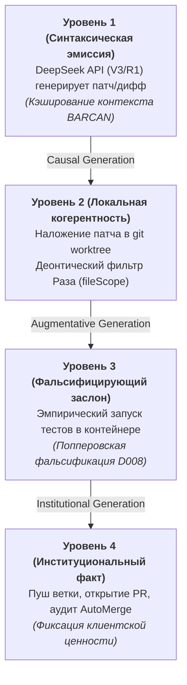

# АРХИТЕКТУРНЫЙ И ИНЖЕНЕРНЫЙ ПЛАН: ЗАМЕНА ВНЕШНЕГО JULES НА СУВЕРЕННЫЙ ПУЛ ВОРКЕРОВ (DEEPSEEK API + GIT WORKTREE)

> **Статус документа:** ФАЗА 1 — ПРОЕКТИРОВАНИЕ И ПЛАН НА СОГЛАСОВАНИЕ С ОПЕРАТОРОМ (ДМИТРИЕМ ЕФРЕМОВЫМ).  
> **Ограничение фазы:** Исходный код Java (`src/`) неприкосновенен до утверждения плана.  
> **Дата формирования:** 2026-11-01  
> **Авторы:** Менеджер-философ (L1/L3) & Ведущий инженер (L2) EneikProductionSys

---

## РАЗДЕЛ 1. ОНТОЛОГИЧЕСКАЯ И АРХИТЕКТУРНАЯ КОНЦЕПЦИЯ (L1 / L3 МЕНЕДЖЕР-ФИЛОСОФ)

### 1.1. Догмат Суверенитета: Переход от внешней «чёрной коробки» Jules к суверенному пулу исполнения

Текущий внешний исполнитель **Google Jules API (`jules.googleapis.com`)** представляет собой облачную «чёрную коробку» (Black Box), обладающую фундаментальными онтологическими пороками:
1. **Эпистемическая непрозрачность (Epistemic Opacity):** Фабрика не видит пошагового хода мыслей, исполнения команд и состояния файловой системы во время работы сессии. Доступны лишь запоздалые логи активностей (`fetchActivitiesPageWithShrink`), из-за чего оркестратор вынужден эвристически угадывать зависания (`detectStuck`, `HONOR_DAVIDSON_PROGRESS_EVIDENCE`).
2. **Сессионный дрейф и рассинхронизация:** Неконтролируемое создание веток и PR на стороне Google Cloud приводит к зомби-сессиям, ложным блокировкам пула аккаунтов (`lockNextJulesAccountWithCapacity`) и расхождениям с физической правдой репозитория (`reconcileTaskStatusAgainstGitHubTruth`).
3. **Хрупкость внешних квот:** Жёсткие лимиты сессий на аккаунт, отказ привязки репозиториев (`SourceCheckResult.MISSING`) и задержки создания сессий парализуют конвейер.

**Решение: Суверенный локально-гибридный контур.**  
Фабрика сохраняет **100% своего интеллекта и ролевой онтологии**:
- Вся система ролевых хартий **BARCAN-TAG-00..12** (от `BARCAN-TAG-00_CODE-GUARDIAN` до `BARCAN-TAG-12_SOCIAL-CONTRACT`) остаётся ядром генерации промптов и контекста.
- Архитектурная декомпозиция **TechnicalLeadCompiler** продолжает детерминированно определять `fileScope`, цели задачи (DoD) и канву реализации.
- Контроль за качеством и приёмкой PR сохраняется за **AutoMergeService** и деонтическими фильтрами.
- Заменяется исключительно **исполнительная мощность**: вместо непрозрачного удалённого облака Jules вычисления передаются связке:
  $$\text{Суверенный воркер} = \text{DeepSeek API (V3/R1 с Context Caching)} + \text{Локальный изолированный } \texttt{git worktree} + \text{Headless-исполнитель}$$

---

### 1.2. Физический заслон деонтики Раза (D006: Exclusionary Reasons & Жесткий `fileScope`)

В философии права Джозефа Раза (*Practical Reason and Norms*, 1975) **деонтическое предписание (норма)** действует как *исключающая причина второго порядка* (*exclusionary reason*): она не просто добавляется к балансу аргументов, а **отменяет и запрещает** рассмотрение любых других доводов.

#### Порок старой схемы (Jules):
В Jules предписание `fileScope` отправлялось в текстовом промпте. Языковая модель Jules могла нарушить скоуп, отредактировав сторонние файлы. Фабрика узнавала об этом лишь постфактум — при анализе PR в `AutoMergeService` или `Cross-epic file collision guard`, что порождало конфликты слияния и засорение веток.

#### Новый физический заслон суверенного воркера:
В суверенном пуле воркеров деонтический запрет Раза `D006: PROHIBITION_AS_CODE` реализуется **физически на уровне файловой системы до любого пуша в GitHub**:
1. **Изоляция в `git worktree`:** Каждый такт задачи выполняется в отдельной директории ворктри (`/opt/EneikProductionSys/worktrees/task-{id}`), ответвлённой от целевой ветки.
2. **Pre-Commit Interceptor (Деонтический арбитр):**
   После применения сгенерированного DeepSeek диффа/патча, до выполнения `git commit`, запускается локальный санитарный аудит:
   ```bash
   git status --porcelain
   ```
   Список фактически модифицированных файлов $F_{\text{actual}}$ сравнивается со строгим множеством $F_{\text{declared}} \in \text{task.fileScope}$.
3. **Безусловный отказ (Deterministic Exclusionary Denial):**
   $$\text{Если } \exists f \in F_{\text{actual}} \setminus F_{\text{declared}} \implies \text{ОТМЕНА ТАКТА}$$
   Воркер немедленно выполняет `git checkout -- .`, фиксирует деонтический дефект в журнале и передаёт ошибку в DeepSeek на итерацию исправления без загрязнения репозитория.

---

### 1.3. Уровни действия Голдмана (D010: Epistemic Action Hierarchy & Generation Relation)

Согласно эпистемологии действия Альвина Голдмана (*A Theory of Human Action*, 1970), действие более высокого порядка **генерируется** действиями более низкого порядка через строгие каузальные отношения генерации (*conventional and causal generation*). 

Жизненный цикл суверенного воркера декомпозируется на 4 строгих уровня:



- **Уровень 1 (Генерация кода):** DeepSeek API принимает сжатую ролевую хартию BARCAN, DoD вишлиста и вычисленный `fileScope`. Результат — структурированный unified diff или файловый набор.
- **Уровень 2 (Файловый контур):** Применение изменений в `git worktree`. Синтаксическая валидация (компилируемость, отсутствие синтаксического шума, соответствие `fileScope`).
- **Уровень 3 (Фальсификация):** Локальная или контейнерная прогонка верификатора (`mvn test-compile`, unit-тесты, линтеры).
- **Уровень 4 (Институционализация):** Коммит, пуш ветки `feature/...` в GitHub, создание PR и передача на приёмку `AutoMergeService`.

---

### 1.4. Фальсификация Поппера (D008: Conjectures and Refutations)

Карл Поппер (*Conjectures and Refutations*, 1963) доказал, что никакое количество подтверждающих примеров не делает гипотезу истинной; наука движется вперёд только через **опровержение ложных гипотез**.

- Сгенерированный LLM код признаётся **Смелой Гипотезой (Bold Conjecture)** с нулевым априорным доверием.
- Воркер не верит текстовым заверениям нейросети («код протестирован и готов»).
- Код подвергается **Жесткому Тесту (Severe Test)**:
  - Патч обязан скомпилироваться в строгом окружении.
  - Если к задаче привязан падающий тест-заслон — он обязан стать зелёным.
  - Ни один ранее зелёный регрессионный тест не должен упасть.
- Если тест падает, гипотеза фальсифицирована: воркер формирует структурированный отчёт об ошибке и отправляет его в DeepSeek в рамках текущего контекста (до 2 попыток рефлексии). Если гипотеза не подтверждается — задача отправляется на карантин без создания мусорных PR в GitHub.

---

### 1.5. Четырёхзначная логика Белнапа (D012: Belnap 4-Valued Truth Logic) в оркестрации

Классическая булева логика ($\{\text{true}, \text{false}\}$) неприменима к распределённой фабрике с асинхронными агентами. Нуэля Белнап (*A Useful Four-Valued Logic*, 1977) предложил 4 истинностных значения:
- $\mathbf{T}$ (True — Только Истина): Патч применён, тесты пройдены, `fileScope` чист, PR готов к мерджу.
- $\mathbf{F}$ (False — Только Ложь): Патч некорректен, тесты упали, ошибка сборки (фальсифицировано).
- $\mathbf{N}$ (Neither / None — Нет данных): Задача отправлена в DeepSeek, генерация продолжается, или запрос в очереди (таймаут не превышен).
- $\mathbf{B}$ (Both — Конфликт / Противоречие): Патч успешно проходит локальные тесты, но конфликтует с изменениями в `main`, либо нарушает глобальный инвариант фабрики.

```
                  Top: Both (B) [Конфликт / Противоречие]
                     /       \
                    /         \
       True (T) [Успех]     False (F) [Фальсификация]
                    \         /
                     \       /
                 Bottom: Neither (N) [Ожидание / Неизвестно]
```

Оркестратор фабрики переводится с наивных флагов статуса на строгую модель состояний Белнапа. Это исключит проблему зависших сессий (`stuck`), так как состояние $\mathbf{N}$ ограничено детерминированным тайм-аутом, а $\mathbf{B}$ мгновенно эскалируется в механизм разрешения конфликтов.

---

### 1.6. Бюджет ресурсов Hetzner: Архитектура Бережливости (Frugal Engineering)

Сервер Hetzner обладает жестко фиксированными ресурсами:
- **2 vCPU**
- **3.7 GiB RAM** (в настоящий момент свободно **~2.2 GiB RAM** с учётом буферов/кэша хоста)
- **13 GiB свободного диска** (диск `/` занят на 65%, норматив — строго $< 70\%$)

Для гарантированного соблюдения ресурсного инварианта и предотвращения OOM Killer проектируется **двухконтурное разделение нагрузки**:

| Контур | Тип нагрузки | Потребление ресурсов | Механизм изоляции |
|---|---|---|---|
| **Интеллектуальный генератор (DeepSeek API)** | Сетевой I/O, потоковый HTTP, работа со строками | **< 25 МБ RAM, < 5% CPU** | Неблокирующий Java `HttpClient` / WebClient. Без локальных нейросетей! |
| **Файловый контур (`git worktree`)** | Локальные git-операции, наложение патчей | **< 10 МБ RAM, < 50 МБ диска** на воркер | `git worktree add --detach` (разделяет `.git/objects`, не дублирует историю) |
| **Локальная верификация (Unit tests / Lint)** | Запуск Java / Node.js компилятора | **Строгий лимит: 1 контейнер, RAM $\le$ 1.2 GiB, CPU $\le$ 1.5** | Docker с семафором `Permits = 1`. Параллельный запуск двух сборок на хосте запрещён! |
| **Тяжелые интеграционные тесты / E2E** | Полная сборка, Playwright, Spring Boot Test | **0 МБ RAM хоста** | Делегирование в GitHub Actions CI через созданный PR |

#### Context Caching в DeepSeek API:
Ролевые хартии BARCAN, архитектурные гайды и системные правила составляют стабильную базу объёмом 30–60 КБ текста (~15K токенов).  
Использование **DeepSeek Prompt / Context Caching**:
- Ускоряет генерацию в 4–10 раз (TTFT падает до сотен миллисекунд).
- Снижает стоимость входных токенов на **90%** (кэшированные токены тарифицируются со скидкой $0.014 / 1M токенов).

---

### 1.7. Маршрутизация по Cynefin Framework

Задачи фабрики разделяются по фреймворку Дейва Сноудена (Cynefin) на 4 домена для выбора оптимальной вычислительной мощности:

1. **Простой домен (Clear / Simple):**
   - *Характер задач:* Мелкие правки стилей, обновление текстовых констант, правка опечаток, обновление DTO.
   - *Маршрут:* **DeepSeek-V3** (дешево, молниеносно, без оверкилла цепочек рассуждений).
2. **Усложнённый домен (Complicated):**
   - *Характер задач:* Реализация фич по готовому ТЗ, модульные тесты, сервисная логика, контроллеры.
   - *Маршрут:* **DeepSeek-V3** с полным контекстом BARCAN-TAG и строгой декомпозицией `TechnicalLeadCompiler`.
3. **Запутанный домен (Complex):**
   - *Характер задач:* Архитектурный рефакторинг, исправление сложных конкурентных гонок, разрешение многосторонних конфликтов слияния, мета-кайдзен.
   - *Маршрут:* **DeepSeek-R1** (модель глубоких рассуждений / Chain-of-Thought) для нахождения неочевидных инвариантов.
4. **Хаотический домен (Chaotic):**
   - *Характер задач:* Срыв инвариантов, падение базы данных, несовместимость миграций Liquibase/Flyway.
   - *Маршрут:* Модели LLM отстраняются; срабатывает детерминированный откат (Rollback), изоляция задачи в `blocked`, алерт оператору.

---

## РАЗДЕЛ 2. ДЕТАЛЬНЫЙ ИНЖЕНЕРНЫЙ ПЛАН РЕАЛИЗАЦИИ (ЗАДАНИЕ ДЛЯ ВЕДУЩЕГО ИНЖЕНЕРА L2)

> Данный раздел резервируется для детального технического проекта Ведущего инженера (L2).  
> Инженеру предписано описать программную реализацию без модификации `src/main/java` до утверждения плана.

*(Заполняется инженером L2 согласно директивам в `docs/reports/PROGRAMMER_DIRECTIVES.md`)*
