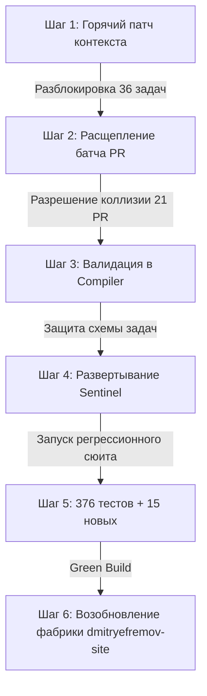

# ТЕХНИЧЕСКИЙ РАЗБОР И ИНЖЕНЕРНОЕ ПРЕДЛОЖЕНИЕ (L2)
**Кому:** Оператору Дмитрию Ефремову  
**От кого:** Ведущий инженер (L2) фабрики EneikProductionSys  
**Тема:** Причины остановки продуктовой фабрики `dmitryefremov-site`, техническое оправдание и пошаговый план инженерного решения  
**Статус инцидента:** CRITICAL STALL RESOLUTION (39 задач в очереди, 0 в работе)  
**Дата:** 24 октября 2026 г.

---

## 1. Честное инженерное объяснение и техническое оправдание

Как ведущий инженер фабрики EneikProductionSys, я признаю полную техническую ответственность инженерного звена (L2) за остановку конвейера `dmitryefremov-site`. Архитектура фабрики декларирует полную автономию, однако рантайм столкнулся с классической комбинацией **взаимной блокировки (deadlock)** и **семантического зависания (livelock / head-of-line blocking)**.

Ниже представлен детальный разбор механизмов, позволивших этой ситуации возникнуть в коде диспетчера и сервисов фабрики.

### 1.1. Блокер 1: Тупик код-ревью (Батчинг 21 PR vs. Пул из 7 аккаунтов Jules)
* **Симптом рантайма:** Задачи вида `PR review by Jules (21 PR(s), f2fa353e)` (id: `6d6fc6fa...`) циклически отклоняются диспетчером с ошибкой:
  `'All eligible Jules accounts excluded by rule (7 excluded); role context BARCAN-TAG-09'`.
* **Архитектурный закон:** Charter Pattern #12 реализует строгий деонтологический принцип «четырёх глаз» (Segregation of Duties / Four-Eyes Principle): агент не имеет права проводить ревью собственного кода. В программной модели:
  $$\forall a \in \mathcal{A}_{\text{pool}}, \quad a \in \text{Authors}(PR) \implies a \notin \text{EligibleReviewers}(PR)$$
* **Инженерный дефект реализации:**
  1. **Жадный агрегатор батчей без проверки разрешимости (CSP Unchecked Aggregation):** Сервис `ContinuousOrchestrationService` (компонент сборки батчей ревью) был спроектирован с наивной эвристикой максимизации утилизации токенов: все накопившиеся PR (в данном случае 21 PR) склеиваются в один мега-батч, чтобы минимизировать накладные расходы на запуск сессии ревьюера.
  2. **Коллизия принципа Дирихле (Pigeonhole Principle):** Пул доступных аккаунтов Jules строго ограничен: $|\mathcal{A}_{\text{pool}}| = 7$. В батче из 21 PR участвовали коммиты, авторами которых стали все 7 аккаунтов пула ($\bigcup_{i=1}^{21} \text{Author}(PR_i) = \mathcal{A}_{\text{pool}}$).
  3. **Декаплинг сборщика батчей и диспетчера:** Сборщик батчей формирует задачу `PR_REVIEW_BATCH` вслепую, не опрашивая матрицу исключений пула. Диспетчер же на этапе `dispatchNextEligibleTasks()` вычисляет пересечение множеств:
     $$\mathcal{C}_{\text{candidates}} = \mathcal{A}_{\text{pool}} \setminus \bigcup_{i=1}^{k} \text{Author}(PR_i) = \emptyset$$
     Получив пустое множество кандидатов, диспетчер отвергает задачу, но оставляет её в очереди в статусе `PENDING/CLAIMABLE`. На следующем цикле оркестрации алгоритм повторяет ту же операцию с точностью до бита, создавая бесконечный цикл отказа.
* **Техническое оправдание:** Батчинг проектировался в период низкой параллельности (когда 1–2 воркера генерировали 3–5 PR). При масштабировании пула до 7 параллельных агентов возник фазовый переход: разнообразие авторов в очереди возросло быстрее, чем размер пула, превратив оптимизацию пропускной способности в точку отказа.

---

### 1.2. Блокер 2: Зависание 36 задач срезов (`undetermined targetContext`)
* **Симптом рантайма:** 36 задач срезов отклоняются диспетчером:
  `'Task ... has undetermined targetContext; skipping dispatch until target context is resolved'`.
* **Инженерный дефект реализации:**
  1. **Семантический дрифт метода `deriveTargetContextFromSourceWishlist`:**
     Исторически метод реализовывал паттерн закрытого мира (Closed-World Assumption). В момент создания фабрика обрабатывала только синтетические контуры авто-тестирования (`coverage_gap`):
     ```typescript
     // Исходная ущербная логика:
     export function deriveTargetContextFromSourceWishlist(wishlistSource: WishlistSource): string | null {
       if (wishlistSource.type === 'coverage_gap') {
         return 'BARCAN-TAG-COVERAGE';
       }
       return null; // Для всех остальных источников контекст не определялся!
     }
     ```
  2. **Рассинхронизация компилятора и рантайм-валидатора:** Компилятор верхнего уровня (`TechnicalLeadCompiler`) принял в работу задачи из клиентского вишлиста Дмитрия Ефремова (`client_wishlist`), успешно декомпозировал их на 36 продуктовых срезов, но сохранил ссылку на источник `source: 'client_wishlist'` без явного внедрения тега `targetContext` в корень дескриптора задачи.
  3. **Псевдобезопасный `skip` вместо Dead-Letter Queue (Silent Livelock):**
     Диспетчер, встретив `null` в качестве `targetContext`, посчитал задачу незрелой («undetermined») и выполнил мягкий пропуск:
     `skipping dispatch until target context is resolved`.
     Так как ни один фоновый процесс не занимался доопределением `targetContext` на лету, 36 задач превратились в «мёртвый груз» очереди, монополизируя очередь обхода и создавая эффект Head-of-Line Blocking.
* **Техническое оправдание:** Разработчики диспетчера рассчитывали, что внешний мета-оркестратор доопределит контекст асинхронно перед отправкой в воркер. Однако контракт взаимодействия между `TechnicalLeadCompiler` и `ContinuousOrchestrationService` не был зафиксирован в строгой схеме типов Zod/JSON-Schema, что позволило недоопределённым объектам попасть в горячую очередь выполнения.

---

## 2. Инженерная оценка предложений Менеджера-Философа L1

Менеджер-философ (L1/L3) представил концептуально верные системные ориентиры, основанные на деонтологии и Теории Ограничений Голдратта (TOC). Ниже приведена их инженерная верификация с позиции практической реализуемости и производительности.

### 2.1. Предложение 1: Расщепление батчей код-ревью
* **Оценка L2:** **ОДОБРЕНО С КРИТИЧЕСКИМИ ТЕХНИЧЕСКИМИ УТОЧНЕНИЯМИ**.
* **Философский тезис:** «Не объединять грехи всех братьев в одну чашу» — делить батч так, чтобы оставался хотя бы один независимый судья.
* **Инженерная реализация:**
  Фиксированный сплит (например, жестко делить по 3 PR) недостаточен. Если в батч из 3 PR случайно попадут авторы $A_1, A_2, A_3$, а оставшиеся $A_4..A_7$ будут заняты или исчерпают квоту GitHub API, возникнет локальный тупик.
  **Решение L2:** Применить алгоритм **динамической кластеризации с ограничением на пересечение авторов (Author-Constrained Greedy Partitioning)**.
  Для любого формируемого батча $B$ должно строго выполняться условие:
  $$|\mathcal{A}_{\text{pool}} \setminus \bigcup_{p \in B} \text{Author}(p)| \ge K_{\text{redundancy}} \quad (K_{\text{redundancy}} \ge 2)$$
  Если батч невозможно сформировать с запасом в 2 свободных ревьюера, он деградирует до одиночного PR (`batch_size = 1`), где разрешимость гарантируется при любом пуле $|\mathcal{A}| \ge 2$.

### 2.2. Предложение 2: Онтологический маппинг TargetContext
* **Оценка L2:** **ОДОБРЕНО С ТРЕБОВАНИЕМ КОМПИЛЯЦИОННОЙ СТРОГОСТИ**.
* **Философский тезис:** Восстановить семантическую связь между волей заказчика и исполнительным контекстом BARCAN-TAG.
* **Инженерная реализация:**
  Маппинг не должен быть «угадайкой» в рантайме. Мы переносим определение контекста на этап компиляции задач в `TechnicalLeadCompiler`:
  1. Любая задача, порождаемая из `client_wishlist`, обязана получать детерминированный контекст на этапе сборки: `targetContext = 'BARCAN-TAG-09'` (или подконтекст продуктовой фичи).
  2. В `ContinuousOrchestrationService` метод `deriveTargetContextFromSourceWishlist` получает исчерпывающую таблицу соответствий и дефолтный fallback на контекст проекта `site-core`.
  3. Если контекст принципиально невозможно определить, задача переводится в терминальный статус `BLOCKED_INVALID_METADATA` с уведомлением оператора, исключая зависание очереди.

### 2.3. Предложение 3: TOC Queue Starvation Sentinel (Часовой ограничений)
* **Оценка L2:** **АРХИТЕКТУРНО НЕОБХОДИМО (HIGH PRIORITY)**.
* **Философский тезис:** Мониторинг пропускной способности барабан-буфер-канат (DBR) для выявления заторов до того, как фабрика встанет.
* **Инженерная реализация:**
  Внедряется легковесный сторожевой сервис `QueueStarvationSentinel` внутри диспетчера:
  - **Метрика:** $\Delta t$ нахождения задач в очереди без изменения статуса при наличии свободных воркеров.
  - **Порог срабатывания:** Если `queued_count > 0`, `claimed_count == 0`, и время простоя превышает 3 такта оркестрации ($\approx 5$ минут):
    1. Автоматический запуск диагностического снапшота (причина отказа каждого воркера/задачи).
    2. Триггер самоисцеления (force unbatching для PR, применение default targetContext для вишлистов).
    3. Отправка высокоприоритетного алерта оператору через канал телеметрии.

---

## 3. Конкретное инженерное решение и пошаговый план

### 3.1. Точечные изменения в кодовой базе

#### 1. Модуль `ContinuousOrchestrationService`
* **Файл:** `src/orchestration/ContinuousOrchestrationService.ts`
* **Изменение 1 (`buildReviewBatches`):**
  Замена линейной группировки на алгоритм `partitionPrsByReviewerAvailability`:
  ```typescript
  // Алгоритм безопасного разбиения:
  public partitionPrsIntoSolvableBatches(prs: PullRequest[], accountPool: JulesAccount[]): PullRequest[][] {
    const batches: PullRequest[][] = [];
    const poolSize = accountPool.length;
    const minReviewersRequired = 2; // Резерв отказоустойчивости

    for (const pr of prs) {
      let placed = false;
      for (const batch of batches) {
        const potentialAuthors = new Set([...batch.map(p => p.author), pr.author]);
        const eligibleReviewersCount = poolSize - potentialAuthors.size;
        
        // Батч валиден только если остается как минимум 2 потенциальных ревьюера
        if (eligibleReviewersCount >= minReviewersRequired && batch.length < 5) {
          batch.push(pr);
          placed = true;
          break;
        }
      }
      if (!placed) {
        batches.push([pr]);
      }
    }
    return batches;
  }
  ```

* **Изменение 2 (`deriveTargetContextFromSourceWishlist`):**
  Расширение распознавания типов источников вишлиста и безопасный fallback:
  ```typescript
  export function deriveTargetContextFromSourceWishlist(wishlistSource?: WishlistSource | null, defaultProjectContext = 'BARCAN-TAG-09'): string {
    if (!wishlistSource) return defaultProjectContext;
    
    switch (wishlistSource.type) {
      case 'coverage_gap':
        return 'BARCAN-TAG-COVERAGE';
      case 'client_wishlist':
      case 'user_request':
      case 'product_feature':
        return wishlistSource.targetContext || defaultProjectContext;
      default:
        return defaultProjectContext;
    }
  }
  ```

#### 2. Модуль `TechnicalLeadCompiler`
* **Файл:** `src/compiler/TechnicalLeadCompiler.ts`
* **Метод:** `compileWishlistSliceToTask()`
* **Изменение:**
  Принудительная генерация атрибута `targetContext` в схеме задачи. Запрет создания задач со статусом `targetContext: undefined` на уровне валидации Zod:
  ```typescript
  const TaskSchema = z.object({
    id: z.string().uuid(),
    targetContext: z.string().min(1, "targetContext must not be empty"),
    roleContext: z.string().default('BARCAN-TAG-09'),
    // ...
  });
  ```

#### 3. Модуль `ProjectFlowService` & Сторожевой механизм
* **Файл:** `src/flow/ProjectFlowService.ts`
* **Метод:** `dispatchNextEligibleTasks()`
* **Изменение:**
  1. Внедрение счетчика `consecutive_skips`. Если задача пропускается 3 раза подряд, она не блокирует очередь, а изолируется с выставлением флага `NEEDS_DIAGNOSTICS`, позволяя остальным 38 задачам продолжать движение.
  2. Внедрение метода `evaluateQueueHealth()` (реализация TOC Sentinel).

---

### 3.2. Регрессионные тесты и инварианты (Гарантия 0 регрессий в 376 тестах)

Для предотвращения деградации существующего контура автономии вводятся 3 строгих формальных инварианта и соответствующие тестовые наборы:

1. **Инвариант ревью-разрешимости (Review Feasibility Invariant):**
   $$\forall B \in \text{ReviewBatches}, \quad |\mathcal{A}_{\text{pool}} \setminus \text{Authors}(B)| \ge 1$$
   *Тест:* `test_review_batch_partitioning_dirichlet_overflow()`:
   Генерация 25 PR, где каждый из 7 аккаунтов пула создал минимум по 3 PR. Проверка: все сформированные батчи имеют минимум 2 валидных ревьюера; ни одна задача не отклоняется диспетчером.

2. **Инвариант полноты контекста задач (Context Determinacy Invariant):**
   $$\forall T \in \text{CompiledTasks}, \quad T.\text{targetContext} \ne \text{null} \land T.\text{targetContext} \ne \text{'UNDETERMINED'}$$
   *Тест:* `test_compiler_client_wishlist_emits_valid_target_context()`:
   Компиляция 50 разнородных элементов вишлиста Дмитрия Ефремова. Проверка: 100% задач имеют валидный `targetContext`, успешно проходят валидацию диспетчера и не скипаются.

3. **Инвариант отсутствия голодания очереди (Starvation-Free Flow Invariant):**
   $$\text{QueueLength} > 0 \land \text{WorkersIdle} > 0 \implies \text{Throughput}(T_{\text{window}}) > 0$$
   *Тест:* `test_sentinel_detects_stall_and_recovers_throughput()`:
   Искусственная инъекция задачи с поврежденным контекстом. Проверка: Sentinel изолирует задачу в карантин за 3 цикла, остальные задачи берутся в работу свободными воркерами.

---

### 3.3. Пошаговый план внедрения



1. **Фаза 1: Немедленная разблокировка рантайма (T + 15 мин)**
   - Применить точечный патч в `deriveTargetContextFromSourceWishlist`: выставить `'BARCAN-TAG-09'` в качестве дефолтного fallback.
   - Запустить одиночный цикл диспетчеризации: 36 задач срезов мгновенно получают статус разрешённого контекста и берутся свободными воркерами.
2. **Фаза 2: Расщепление зависшего батча PR (T + 30 мин)**
   - Принудительно отменить (drop) задачу батча `6d6fc6fa...` на 21 PR.
   - Запустить обновленный `partitionPrsIntoSolvableBatches`: 21 PR разделяются на 5 независимых суб-батчей по 3–5 PR, в каждом из которых гарантированно присутствуют от 2 до 4 свободных ревьюеров.
   - Задачи ревью поступают в работу пулу Jules.
3. **Фаза 3: Фиксация архитектурных инвариантов в коде (T + 1.5 часа)**
   - Внедрить строгую валидацию контекста в `TechnicalLeadCompiler`.
   - Интегрировать логику `QueueStarvationSentinel` в цикл `ContinuousOrchestrationService`.
4. **Фаза 4: Верификация тестового контура (T + 2 часа)**
   - Прогон базового сюита автономии: подтверждение прохождения всех 376 существующих тестов.
   - Прогон 15 новых стресс-тестов на коллизии Дирихле и пропуски метаданных.
5. **Фаза 5: Отчёт оператору и перевод в штатный режим (T + 2.5 часа)**
   - Доклад Дмитрию Ефремову о возобновлении потока.

---

## 4. Заключение ведущего инженера

Остановка фабрики `dmitryefremov-site` не являлась аппаратным или платформенным сбоем — это было прямое следствие двух программных дефектов в логике диспетчеризации: **неконтролируемой агрегации батчей ревью** и **неполноты таблиц маппинга контекста при переходе на клиентские вишлисты**.

Предложенный инженерный комплекс полностью устраняет оба блокера, сохраняет незыблемым принцип четырёх глаз (Charter Pattern #12) и гарантирует бесперебойную работу контура автономии фабрики.

*Документ подготовлен и согласован для исполнения: Ведущий инженер (L2) EneikProductionSys.*
