# Объяснение и Архитектурное Предложение Менеджера-Философа (L1/L3)
## По факту многочасового останова продуктовой фабрики `dmitryefremov-site`

**Дата:** 24 октября 2026 г.  
**От кого:** Менеджер-философ фабрики EneikProductionSys (L1 Epistemic Grounding / L3 Strategic Flow Governance)  
**Кому:** Оператор Дмитрий Ефремов  
**Статус:** CRITICAL_OPERATIONAL_INTERVENTION  
**Объект инцидента:** Продуктовая фабрика `dmitryefremov-site` (рантайм Hetzner / Flow Core)  
**Симптоматика:** 39 задач в очереди `queued`, 0 задач в работе `claimed`, фабрика заблокирована на протяжении многих часов.

---

## 1. Честное объяснение и философско-системное оправдание

### 1.1. Анатомия двойного тупика

Живой рантайм фабрики столкнулся не со случайным аппаратным или сетевым сбоем, а с классическим **системным ступором саморегуляции (Homeostatic Deadlock)**. Фабрика оказалась парализована двумя независимыми, но синергетически усиливающими друг друга дефектами в контуре диспетчеризации:

#### Блокер 1: Деонтическая антиномия коллективной дисквалификации (Код дефекта D006 / D011)
- **Фактическое состояние:** Диспетчер отклоняет задачу `PR review by Jules (21 PR(s), f2fa353e)` (id: `6d6fc6fa...`) с вердиктом:  
  `All eligible Jules accounts excluded by rule (7 excluded); role context BARCAN-TAG-09`.
- **Механизм коллизии:** Батчер объединил в единую задачу ревью 21 Pull Request. В соответствии с **Charter Pattern #12** (*«Запрет самоаттестации: автор PR не имеет права быть его ревьюером»*), метод `implementerAccountNamesForReviewFallback` обошел все 21 PR и собрал множество их авторов. Так как исторически эти 21 PR создавались всеми 7 доступными аккаунтами пула (`Jules-01` .. `Jules-07`), множество исключаемых аккаунтов $E$ составило полную мощность пула:  
  $$E = \bigcup_{i=1}^{21} \text{author}(PR_i) = \{\text{Jules-01}, \dots, \text{Jules-07}\} = \text{Pool}$$
- **Логико-философский корень ошибки:** Произошла мерологическая ошибка композиции (Джонатан Шаффер, `PART_WHOLE_OWNERSHIP` / D004) и подмена квантора в деонтической логике норм (Джозеф Раз, `PROHIBITION_AS_CODE` / D006). Индивидуальное этическое предписание:
  $$\forall i \in [1, n], \; \forall a \in \text{Pool}: \quad a = \text{author}(PR_i) \implies \Box \neg \text{CanReview}(a, PR_i)$$
  было некорректно возведено в коллективное запрещение на агрегат:
  $$\forall a \in \text{Pool}: \quad \left(\exists i \in [1, n]: a = \text{author}(PR_i)\right) \implies \Box \neg \text{CanReview}(a, \text{Batch})$$
  В результате деонтическая система потребовала совершить действие (провести ревью батча), одновременно наложив категорический запрет на всех возможных агентов во вселенной универсума ($\forall a \in \text{Pool}: \Box \neg \text{Act}(a)$). Возникла неразрешимая антиномия: нормативная невозможность исполнения.

#### Блокер 2: Категориальная ошибка онтологического контекста (Код дефекта D002 / D012)
- **Фактическое состояние:** 36 продуктовых задач срезов циклически сбрасываются диспетчером:  
  `Task ... has undetermined targetContext; skipping dispatch until target context is resolved`.
- **Механизм коллизии:** В методе `ProjectFlowService.dispatchQueuedTasks` задачи без `targetContext` направляются в резолвер `deriveTargetContextFromSourceWishlist(task)`. Однако этот метод был запрограммирован в рестриктивно-усеченном виде: он признавал исключительно `WishlistSource.coverage_gap`, а для задач клиентского вишлиста (`WishlistSource.client`) возвращал `null`. Из-за этого поле `targetContext` оставалось `UNDETERMINED`, задача не допускалась к внешнему запуску по Закону 2 (изоляция носителей и демаркация сред) и сбрасывалась обратно в очередь без продвижения.
- **Логико-философский корень ошибки:** Догматический буквализм и категориальная ошибка (Гилберт Райл / Рут Баркан Маркус, `INDEXICAL_CONTEXT_LOCK` / D006). Инженерная посылка гласила: *«Мы не имеем права слепо подставлять PRODUCT_CODEBASE по умолчанию, чтобы носители фабрики случайно не загрязнили клиентский код»*. Однако применение этого принципа к клиентскому вишлисту стало абсурдом. По самой своей интенциональной природе (теория жесткой десигнации Сола Крипке и актуалистские объекты Баркан Маркус), требование внешнего клиента, переданное фабрике `dmitryefremov-site`, **аналитически жестко десигнирует продукт клиента**: клиент не может заказывать доработку внутреннего оркестратора Eneik. Не признать `PRODUCT_CODEBASE` для `WishlistSource.client` — значит отрицать фундаментальный контракт фабрики как инструмента производства ценности.

---

### 1.2. Почему автономия фабрики допустила многочасовое зависание?

Фабрика построена на гомеостатических принципах (Dennettian Multiple Drafts, кибернетический баланс Эшби). Почему же этот гомеостаз не восстановил поток, а замерз?

1. **Иллюзия локального благополучия (Silent Poka-Yoke Dysphoria):**
   Ни один компонент не падал с фатальным исключением `Exception` или кодом 500. Все 39 задач обрабатывались в штатном цикле:
   - Диспетчер аккуратно вызывал `continue`;
   - Защита бюджета попыток не списывала задачи в `failed`, потому что формально не было внешнего отказа API Jules;
   - Батч ревью получал штатный вердикт `EXCLUDED_BY_RULE` и возвращался в очередь на следующий такт.
   Для мониторинга процессов всё выглядело как штатная работа: транзакции коммитятся, потоки живы, логи пишутся.

2. **Разрыв телеосемантического контура (Dretske Teleosemantic Feedback Failure / D011):**
   Гомеостаз фабрики следил за локальными запретами (не допустить саморевью, не допустить побега контекста), но потерял высший системный критерий (Телос): **прохождение потока (Throughput > 0)** по Голдратту (Theory of Constraints). Охранные механизмы (Poka-Yoke) превратились из средств защиты потока в непреодолимые запруды. Фабрика впала в «кантовский догматический сон»: нормы чистоты соблюдены на 100%, но продукт не строится.

---

## 2. Строгое архитектурное предложение по устранению блокеров

Опираясь на принципы деонтологии (Джозеф Раз), онтологической чистоты (BARCAN-TAG, Крипке, Варци) и методологии Lean Six Sigma DMAIC / TOC (Голдратт, Барабан-Буфер-Канат), формулируется следующее решение:

```mermaid
flowchart TD
    subgraph Blocker1["Устранение Блокера 1: PR Review Author Collision"]
        PRBatch["PR Review Batch (21 PRs)"] --> DetectCollision{"|U Authors| == |Pool| ?"}
        DetectCollision -- Да: Коллизия пула --> Atomize["Single-Piece Flow: Расщепление батча на микро-батчи или атомарные PR"]
        Atomize --> FilterDisjoint["Формирование батча с условием: Pool \\ Authors(Batch) ≠ ∅"]
        FilterDisjoint --> AdmitReviewer["Назначение свободного независимого аккаунта Jules"]
        DetectCollision -- Нет --> DirectDispatch["Штатный диспатч"]
    end

    subgraph Blocker2["Устранение Блокера 2: Undetermined TargetContext"]
        TaskQueue["Задача среза в очереди"] --> CheckContext{"targetContext == null / UNDETERMINED?"}
        CheckContext -- Да --> DeriveContext["deriveTargetContextFromSourceWishlist"]
        DeriveContext --> CheckSource{"Источник вишлиста?"}
        CheckSource -- client / coverage_gap / defect --> ProductCode["TargetContext.PRODUCT_CODEBASE (Аксиома клиента)"]
        CheckSource -- orchestrator_housekeeping --> OrchestratorCode["TargetContext.ORCHESTRATOR_SYSTEM"]
        ProductCode --> ValidDispatch["Успешный допуск к раздаче (Dispatched)"]
    end
```

### 2.1. Устранение Блокера 1: Мерологическая декомпозиция батча код-ревью (Lean Single-Piece Flow + Деонтологическое разведение)

#### Принцип TOC / Lean Six Sigma:
Батч из 21 PR нарушает базовый закон бережливого производства (WIP Over-accumulation). Накопление 21 PR в одну задачу создает «эффект слона в узком проходе»: требования к исполнителю агрегируются, сужая доступную емкость до нуля.

#### Архитектурное правило:
1. **Дистрибутивное разделение ответственности (Distributive Partitioning):**
   При формировании батча задач ревью должно выполняться инвариантное условие неполноты покрытия авторами пула:
   $$\left| \bigcup_{PR \in Batch} \text{author}(PR) \right| \le |\text{Pool}_{\text{eligible}}| - 1$$
   Батч ревью формируется только из тех PR, чье объединенное авторство оставляет хотя бы **один** аккаунт в пуле, не участвовавший в написании ни одного из этих PR.
2. **Атомизация до Single-Piece Flow при коллизии:**
   Если накопившиеся PR перекрывают весь пул, система обязана автоматически расщепить мега-батч на атомарные задачи ревью (1 PR = 1 задача ревью, либо малые дизъюнктные кластеры по 2–3 PR). Для каждого отдельного PR $PR_k$ с автором $A_k$ доступно ровно $|\text{Pool}| - 1 = 6$ независимых ревьюеров! Тупик исчезает тривиально и детерминированно.
3. **Poka-Yoke на этапе диспетчеризации:**
   Если в очереди уже оказалась объединенная задача с коллизией всех 7 авторов (как `6d6fc6fa...`), диспетчер не должен бесконечно сбрасывать ее с `EXCLUDED_BY_RULE`. Он обязан перевести ее в режим авто-декомпозиции: разбить на подзадачи с независимыми PR и аннулировать блокирующий супер-батч.

---

### 2.2. Устранение Блокера 2: Полная онтологическая решетка контекстов целевого репозитория (BARCAN-TAG-01 / Белнап 4-значная логика)

#### Принцип онтологической демаркации:
В соответствии с логикой Белнапа (D009 / D012) и принципом жесткой десигнации (D001 / D006), маппинг источника вишлиста в целевой репозиторий должен быть **замкнутым и полным**, исключающим возникновение `UNDETERMINED` для валидных источников.

#### Архитектурное правило:
В `ProjectFlowService.deriveTargetContextFromSourceWishlist` закрепляется исчерпывающая истинностная таблица:

| `WishlistSource` | Целевой контекст (`TargetContext`) | Обоснование онтологии |
| :--- | :--- | :--- |
| `client` | `PRODUCT_CODEBASE` | **Аксиома суверенитета клиента:** цель фабрики — кодовая база продукта клиента. |
| `coverage_gap` | `PRODUCT_CODEBASE` | Восполнение пробела спецификации в кодовой базе продукта. |
| `runtime_observability_gap` | `PRODUCT_CODEBASE` | Добавление метрик и наблюдаемости в код продукта. |
| `design_review_concern_pattern` | `PRODUCT_CODEBASE` | Правка верстки и UI в репозитории продукта. |
| `design_system_falsification` | `PRODUCT_CODEBASE` | Приведение дизайн-токенов в коде продукта к эталону. |
| `self_falsification` | `PRODUCT_CODEBASE` | Устранение дефектов реализации продуктовой логики. |
| `role_mismatch_followup` | `PRODUCT_CODEBASE` | Возобновление прерванной задачи продуктового среза. |
| `orchestrator_repair` / `housekeeping` | `ORCHESTRATOR_SYSTEM` | Внутреннее обслуживание фабрики. |
| `null` / неизвестный источник | `UNDETERMINED` (с алертом) | Настоящий дефект демаркации, требующий вмешательства. |

Дополнительно: в момент генерации срезов компилятором (`buildTaskGraphForOneEpic` и `createAndSaveTask`) поле `targetContext` задачи должно жестко выставляться в `PRODUCT_CODEBASE`, если родительский вишлист имеет `WishlistSource.client` (Poka-Yoke на источнике, предотвращающий появление `null` еще до попадания в очередь).

---

### 2.3. Мета-страж против зависаний потока (TOC Queue Starvation Sentinel)

Чтобы автономия фабрики никогда больше не допускала «вежливого многочасового ступора»:
1. Вводится метрика **TOC Stagnation Watermark**: если в очереди Flow Core висят задачи со статусом `queued` ($N > 0$), а активных задач в работе нет ($WIP_{\text{claimed}} = 0$) в течение более **10 минут** (10 оркестрационных тактов), это классифицируется не как «ожидание», а как **CRITICAL_FLOW_STALL**.
2. Сторожевой таймер публикует инцидент в `DefectJournal` (категория `FLOW`, тип `QUEUE_DISPATCH_STARVATION`), агрегирует список причин отказов из `julesDispatchStatus` и активирует самоисцеляющий протокол:
   - Автоматический роспуск застрявших супер-батчей код-ревью;
   - Автоматический пре-резолв известных контекстов;
   - Подъем высокоприоритетного операторского уведомления в дашборд.

---

## 3. Резюме для Оператора

Оба блокера носят характер **концептуальной ошибки чрезмерного ужесточения локальных запретов при отсутствии системной компенсации**:
- Правило #12 (не судить свой PR) верно, но его слепое применение к батчу из 21 PR превратило защиту от пристрастности в запрет на работу для всех 7 доступных аккаунтов.
- Закон 2 (демаркация сред) верен, но отказ считать клиентские требования направленными на код продукта превратил защиту от загрязнения в саботаж клиентского вишлиста.

Предложенные изменения восстанавливают баланс: **защитные инварианты сохраняются в сильной форме**, но выражаются через дистрибутивную декомпозицию и полную онтологическую типизацию, навсегда исключая возможность взаимной блокировки.

*Отчет подготовлен и зафиксирован в институциональном реестре фабрики.*
